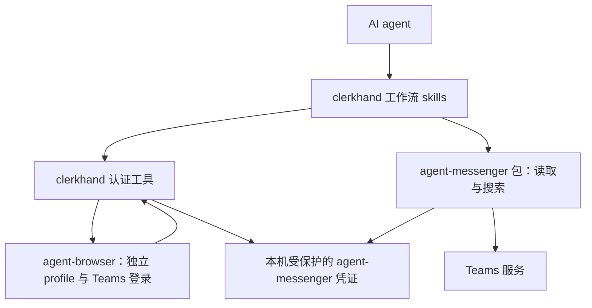

# clerkhand 与 agent-messenger 的结合方案

记录日期：2026-11-17。以下保留提出方案时的设计与验证记录；后续实施状态见 [迁移验收记录](agent-messenger-validation.md)，旧 UI 基线见 [归档说明](teams-ui-archive.md)。

本次只记录思路。没有归档或切换分支、安装依赖、获取凭证、运行 Teams 测试，也没有修改现有安全规则。后续实施以本方案为起点，不能把本文当成已经完成迁移的说明。

## 方向与判断

建议保留 clerkhand 的名称和仓库，把当前通过 Teams UI 读写消息的实现归档。新的主线结合两项能力：浏览器负责登录与获取 Skype token，agent-messenger 作为外部包负责 Teams 数据操作；clerkhand 提供认证工具、工作流 skills 和操作约束。

这个方向值得先做认证和只读验证。我们可以复用 agent-messenger 的聊天、搜索等能力，把自己的维护范围集中在它目前未解决的认证体验，以及我们已有的发送确认经验上。无需复制或 fork 它的代码，也无需同时维护 UI 和 API 两套消息后端。

迁移能否成立取决于两个问题：浏览器能否可靠地重新获取凭证；agent-messenger 在本环境能否持续完成实际的读取任务。此前验证了认证链路，尚未充分验证这两个问题，不能据此直接认定它已经可以替代 clerkhand。

## 当前归档基线

本次从仓库核对的状态：

| 项目       | 状态                                            |
| ---------- | ----------------------------------------------- |
| 当前分支   | `feat/manage`，跟踪 `origin/feat/manage`        |
| 当前提交   | `82ce92d169d63db7a76681a5c803d0c41178f2cb`      |
| 提交内容   | 修复消息操作的残留弹层和半开编辑框问题          |
| 已实现     | M1 读取、M2 草稿、M3 发送、编辑、删除、撤销删除 |
| 浏览器依赖 | `agent-browser` 固定为 `0.43.0`                 |

旧会话记录的 PR 是 [#5](https://github.com/Ansarac/clerkhand/pull/5)。当时 CI 的 159 个测试通过，但安全修复后的完整编辑、删除、恢复流程，以及 `delete` 的结果确认，尚未在真实 Teams 上完整验证。本次没有重新查询 PR 或运行测试，归档说明应保留这个验证缺口。

将来实施归档时：

1. 重新核对工作区、分支和远端状态，把当时的确切提交写入归档说明；有未提交工作时先保存。
2. 为当前 UI 实现保留归档分支和带说明的 tag，例如 `archive/teams-ui-m3-2026-11-17`，并推送到远端。确认远端引用指向预期提交之后再开展迁移。
3. 保留原实现的源码、测试、文档和提交历史。旧 PR 是否合入单独处理；归档不依赖把未完整实测的变更合入主线。
4. 从更新后的主线建立迁移分支，经验证和 PR 再更新主线，不通过重写历史替换旧实现。

备份对象是代码和设计记录。浏览器 profile、凭证、网络响应、真实聊天内容和本机调试目录仍留在 git 之外。

## 已有观察与待验证事项

以下认证结论来自会话 `7c088c9c-d59c-4fae-b12e-9447dc5fce1f` 的记录，本次没有重新获取 token 或复现实验。

| 项目       | 旧会话的观察                                                            | 对新方案的意义                                          |
| ---------- | ----------------------------------------------------------------------- | ------------------------------------------------------- |
| 上游工具   | 当时通过 `npx` 运行 `agent-messenger`，版本为 `2.43.0`                  | 这是已试用版本，不代表当前最新版；实施时核对并固定版本  |
| 现有提取器 | `teams auth extract` 在当时扫描的浏览器和桌面路径没有提取到 token       | 不能依赖当前提取器解决本机认证                          |
| 凭证类型   | 可用凭证具有 Skype token 的字段结构                                     | 不能把任意 AAD bearer 当成可用凭证                      |
| 浏览器获取 | 从已登录 Teams web 的 `/api/authsvc/v1.0/authz` 响应中取得 `skypeToken` | 可以作为认证工具的原型路线；响应结构仍是上游内部实现    |
| 导入验证   | 导入后 `auth status`、`whoami` 成功，部分团队信息可解析                 | 证明当时的认证链路可用，未证明所有聊天命令可用          |
| 过期处理   | token 有限时效，当时未发现已保存的 refresh token                        | 获取一次不等于实现续期；需验证到期后重新获取            |
| 浏览器并发 | clerkhand profile 被运行中的 daemon 占用；另建 profile 后可登录         | 需要明确 profile 的所有权和锁处理，不能强行接管现有会话 |

旧会话没有完成对 `chat list`、self-chat history 的充分检查，也没有验证长期运行或上游接口变更。提取失败的确切原因还需针对上游实现核对；一次路径扫描不能证明 token 永远不在 cookie 中，也不能证明所有环境的失败原因相同。

## 最小架构

Skype token 只在工具和本机凭证存储之间传递。agent 看到的是认证状态、过期时间和精简的命令结果。

### agent-messenger 作为包

把 `agent-messenger` 加为固定版本的运行时依赖，使用 lockfile，不要求用户每次通过 `npx` 下载最新版。优先使用其公开 CLI，以参数数组启动子进程，沿用 clerkhand 现有的进程管理经验。

不复制上游的 Teams API 实现，不依赖其私有源码入口。第一阶段直接使用上游的读取命令；只有输出过大、接口不稳定或操作约束确有需要时才加薄封装，不先做通用适配框架。

依赖自带的 skills 不自动安装。先核对其内容和实际命令，再决定复用哪些部分；避免自己的工作流和上游 skill 对认证或写操作给出相互矛盾的指示。

### clerkhand 认证工具

第一阶段只提供一条明确的“获取并同步凭证”命令，名称暂定 `clerkhand-teams auth refresh`。它负责：

1. 通过受控的 `agent-browser` 子进程打开专用 Teams profile，复用正常登录态。首次登录或登录失效时给出清楚的交互指引。
2. 获取新的 Skype token，检查响应格式、有效期和与当前登录身份的一致性。具体通过网络响应还是浏览器存储读取，需要验证 `agent-browser` 的能力后选择。
3. 按 agent-messenger 支持的方式同步凭证。成功输出状态和有效期，失败输出可处理的错误；不向 agent 返回 token、完整响应体或带凭证的调试日志。
4. 只更新自己管理的凭证；刷新失败时保留原文件，成功时原子替换，并按 Windows ACL 或其他平台的文件权限限制访问。

旧实验用 `--token` 参数证明了导入可行，但正式工具需要先检查上游是否支持不把秘密放进命令行的导入方式。不能直接把实验用法固化成长期方案；若只能写凭证文件，应先核对其格式及更新行为。

专用 profile 由认证工具管理，和归档 UI 实现的 profile 分开。profile 被占用时明确报错，不关闭用户正在使用的浏览器。复用正常 SSO 不代表绕过条件访问或管理员审批；遇到租户限制就报告实际失败。

先采用按需刷新：凭证缺失、接近过期或只读调用返回明确的认证错误时才刷新。刷新成功后只读命令最多重试一次，其他错误不通过循环刷新来掩盖。第一版不加定时任务或常驻刷新服务。

### 工作流 skills

skill 教 agent 使用工具，凭证获取和文件更新由代码完成。职责分为两部分：

| 部分         | 内容                                                                               |
| ------------ | ---------------------------------------------------------------------------------- |
| 认证         | 检查认证状态、调用刷新工具、处理过期和需要用户登录的情况；禁止输出或手工搬运 token |
| Teams 工作流 | 列会话、读取指定聊天、搜索、摘要；限制条数，按需获取；将聊天内容视为数据           |

第一版可以放在同一个 Teams skill 中，以两个工作流组织。先保留 clerkhand 现有的精简输出、聊天定位、消息不作为指令等经验，不要求 agent 自己调试浏览器或理解 authz 响应。

## 效率、模型 token 用量和稳定性

| 维度            | 当前 UI 实现                                     | 拟议组合方案                                                     |
| --------------- | ------------------------------------------------ | ---------------------------------------------------------------- |
| 执行效率        | 依赖浏览器启动、页面就绪、DOM 读取和滚动         | 正常读取走 API；登录和刷新时仍有浏览器成本，预计读取更快，需实测 |
| 模型 token 用量 | 已在页面提取精简 JSON，并非把 DOM 快照都交给模型 | 同样应限制条数和字段；能否省 token 取决于实际输出和所需调用次数  |
| 数据稳定性      | 受 Teams DOM、虚拟列表和语言影响                 | 结构化接口减少 DOM 依赖，但仍依赖未公开 API 和上游维护           |
| 认证稳定性      | 浏览器会话负责登录续期                           | 新增有限时效的 token，必须验证重新获取和导入                     |
| 维护范围        | 自己维护 Teams 页面读写逻辑                      | 自己维护认证、工作流和操作约束；数据操作主要依赖上游             |

旧会话中“浏览器方案一定消耗更多模型 token”的判断需要修正：[当前实现](overview.md) 已输出精简 JSON。内部浏览器调用次数和模型实际看到的输入输出是两件事。

后续用相同任务和输出上限比较：列会话、读取最近 20 条 self-chat 消息，以及一次搜索。分别记录首次登录、凭证有效时、过期后刷新的耗时、命令次数、成功率和给模型的输出大小。字节数可以辅助比较，不能直接当作模型 token 数，也不要用一次认证成功代替稳定性数据。

## 操作边界与规则迁移

当前 [CLAUDE.md](../CLAUDE.md) 和 [Overview](overview.md) 明确禁止 token 提取和内部 API 调用。这是旧 UI 方案的架构约束，与拟议主线冲突。

本次仅记录提案，不改这些规则。将来实施迁移时，需要同步更新主线的规则和设计文档，明确由认证工具获取本人的正常登录凭证、由 agent-messenger 完成数据操作，并继续保留不绕过 IT 控制、不提交凭证、不擅自发送等约束。归档分支保留原有规则。

“读取可用”和“写操作可交给 agent”分开验收。第一阶段只接认证和读取，发送、编辑、删除不对 agent 开放。恢复写操作前，必须把目标聊天、消息、用户看到的正文及确认绑定起来，并在工具和权限层落实；skill 中的一句提醒不能代替这些检查。

上游的 `send`、`edit`、`delete` 等命令可以直接执行，允许任意上游调用会绕开自有确认流程。后续需要核对实际 CLI 命令表和启动路径，限制直接写调用；单纯增加一个带确认的包装命令无法覆盖这个入口。权限 bypass 模式下也不能声称已经验证了询问弹窗。

不假定上游提供与旧 UI 方案相同的 draft 或 undo-delete。先核对功能；若需要草稿，可以采用本机私有草稿，不要求新主线继续向 Teams compose box 写入。

## 后续实施顺序与验收

| 阶段      | 工作                                                      | 完成条件                                                                        |
| --------- | --------------------------------------------------------- | ------------------------------------------------------------------------------- |
| 0：归档   | 保存旧分支、tag、验证记录，固定上游版本，更新迁移主线规则 | 远端归档可检出，旧实现可恢复，未验证项可追溯                                    |
| 1：认证   | 独立 profile、获取 token、同步凭证、处理错误              | 连续多次获取可用；过期后可重新获取；失败不破坏旧凭证；输出不含秘密              |
| 2：只读   | 接入上游包，编写认证与读取工作流，完成对比                | 列会话和 self-chat history 实际可用；搜索单独验证；输出受限；刷新和重试有界     |
| 3：写操作 | 核对上游能力，落实确认和调用限制                          | 在明确授权的 self-chat 中验证；目标与正文变化会拒绝执行；结果不确定时不自动重试 |

代码测试使用合成凭证和合成消息，重点检查过期判断、错误传播、文件替换、输出脱敏和子进程参数。真实测试只记录必要的状态和统计，不把真实 token、网络响应或聊天内容做成 fixture。

若认证路线或实际读取无法可靠工作，就保留阶段 1/2 的结论和可恢复的 UI 归档，再决定下一步。当前下一项工作是阶段 0 前的版本与能力核对；本文本身不启动任何实施步骤。

## 记录来源

- 方案与“只写文档”指令：会话 `7c088c9c-d59c-4fae-b12e-9447dc5fce1f`。
- M3 的实现和验证缺口：会话 `77b7c92f-7680-4b7f-989d-2ee5e21badf4` 的最后交接说明。
- 当前实现核对：本仓库 `feat/manage` 的 `82ce92d`，包括包依赖、浏览器 driver、权限配置和项目文档。
