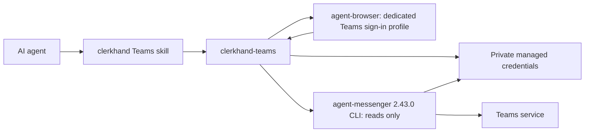

# Overview

`@clerkhand/core` provides the browser driver, platform paths, JSON output and agent setup. `@clerkhand/teams` captures normal browser authentication, verifies it and invokes the public upstream CLI with a fixed read-only command allowlist. It does not copy or import the upstream API implementation.

Reads normally start no browser. When credentials are missing, within five minutes of expiry, or rejected by the service, clerkhand refreshes on demand. A command performs at most one refresh and one authentication-error retry. There is no background service.

Authentication opens `https://teams.cloud.microsoft/` directly and enables capture before navigation. It captures only a successful POST to the Teams HTTPS `/api/authsvc/v1.0/authz` endpoint. If the selected account is already signed in and Teams uses its encrypted Skype cache, the tool invalidates that account's two Skype cache entries and reloads once to request normal renewal, retaining SSO. Skype token expiry and the AAD identity in that same request must match the returned work-account Skype identity. `whoami` verifies the new credential from a private staging directory before the managed file is atomically replaced. Tokens and raw diagnostics stay inside subprocesses and local protected storage.

Chat output is limited to 20 items by default, 200 maximum, and 4,000 characters per message. Fields are explicitly selected; raw response objects and HTML are omitted. This reduces agent-visible output, but does not establish a model token saving or performance comparison against the archived compact UI output.

## Data directory

| Platform | Default                                                 |
| -------- | ------------------------------------------------------- |
| Windows  | `%LOCALAPPDATA%\clerkhand`                              |
| macOS    | `~/Library/Application Support/clerkhand`               |
| Linux    | `$XDG_DATA_HOME/clerkhand` (`~/.local/share/clerkhand`) |

Override with `CLERKHAND_HOME`. The migration uses `teams-auth/profile` and `teams-auth/messenger/teams-credentials.json`, separate from the archived `teams/profile`. Only child processes receive `AGENT_MESSENGER_CONFIG_DIR`; existing user-owned upstream credentials are not modified. A different `CLERKHAND_HOME` gets its own browser session and account.

The profile and credential directory are private: Windows ACLs or Unix directory mode 0700 and file mode 0600. Treat the whole directory like a password. An exclusive operation lock prevents credential changes during reads. An occupied browser profile is rejected without closing the browser.

## Scope and limits

- Work-account authentication, chat list and chat history are implemented.
- Upstream server search requires an AAD refresh token. This version only manages Skype tokens and reports `search_unavailable`.
- Draft, send, edit, delete and restore are disabled pending a separate confirmation and permission design.
- No bypass of conditional access or admin approval. Internal endpoint and upstream changes may break authentication or reading.

See [validation](agent-messenger-validation.md) for measured results and remaining acceptance work, and [archive details](teams-ui-archive.md) for restoring the UI implementation.
