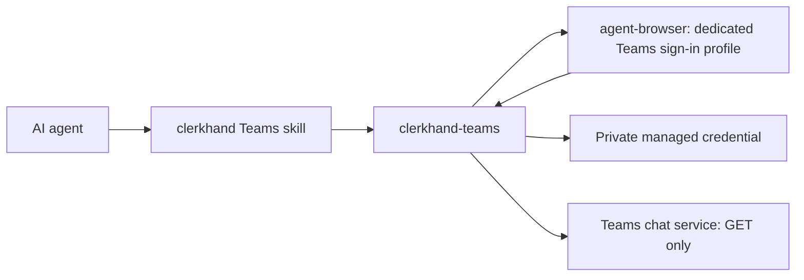

# Overview

`@clerkhand/core` provides the browser driver, platform paths, JSON output and agent setup. `@clerkhand/teams` captures normal browser authentication, verifies it and reads chats with a small built-in client. That client talks only to the regional Teams chat service (`{amer,emea,apac}.ng.msg.teams.microsoft.com/v1`) and has no runtime dependency beyond core. Its only write is a plain-text POST to the user's own self-chat (`48:notes`), with the target fixed in code.

Reads normally start no browser. When credentials are missing, within five minutes of expiry, or rejected by the service, clerkhand refreshes on demand. A command performs at most one refresh and one authentication-error retry. There is no background service.

Authentication opens `https://teams.cloud.microsoft/` directly and enables capture before navigation. It captures only a successful POST to the Teams HTTPS `/api/authsvc/v1.0/authz` endpoint. If the selected account is already signed in and Teams uses its encrypted Skype cache, the tool invalidates that account's two Skype cache entries and reloads once to request normal renewal, retaining SSO. Skype token expiry and the AAD identity in that same request must match the returned work-account Skype identity. The new credential must then pass a Teams identity request, which also finds the user's chat service region, before the managed file is atomically replaced. Tokens stay in memory and local protected storage.

Chat output is limited to 20 items by default, 200 maximum, and 4,000 characters per message. Fields are explicitly selected; rich text is converted to plain text, and raw response objects and HTML are omitted.

## Data directory

| Platform | Default                                                 |
| -------- | ------------------------------------------------------- |
| Windows  | `%LOCALAPPDATA%\clerkhand`                              |
| macOS    | `~/Library/Application Support/clerkhand`               |
| Linux    | `$XDG_DATA_HOME/clerkhand` (`~/.local/share/clerkhand`) |

Override with `CLERKHAND_HOME`. Teams uses `teams-auth/profile` and `teams-auth/credentials.json`. A credential left in `teams-auth/messenger/` by the agent-messenger version is deleted after the next successful refresh. A different `CLERKHAND_HOME` gets its own browser session and account.

The data directory is private: a current-user-only Windows ACL set when the directory is created, or Unix directory mode 0700 and file mode 0600. Treat the whole directory like a password. An exclusive operation lock prevents credential changes during reads. An occupied browser profile is rejected without closing the browser.

## Scope and limits

- Work-account authentication, chat list (self, 1:1 and group chats) and chat history are implemented. Team channels are not listed.
- Server search needs a different token than the Skype credential this flow manages; it is not implemented.
- Sending is limited to the self-chat: `draft` previews the text and a hash, `send --confirm <hash>` sends exactly that text. Edit, delete and restore are disabled.
- No bypass of conditional access or admin approval. Changes to internal Teams endpoints may break authentication or reading.

See [archive details](teams-ui-archive.md) for restoring the UI implementation.
