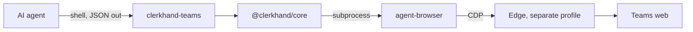

# Overview

- **`@clerkhand/core`**: shared layer for all tools: browser driver, session and profile handling, safety rules, page scripts, JSON output.
- **`@clerkhand/teams`**: the Teams CLI. Each command is one file; Teams-specific page scripts live in `page/`.

Output to the agent is compact JSON extracted in the page, not page snapshots.

## Non-goals

- No token extraction or internal API calls; only the UI the user can already see.
- No bypassing IT controls.
- No fully automatic replies.
- Not a general browser-automation framework.

## Data directory

| Platform | Default                                                 |
| -------- | ------------------------------------------------------- |
| Windows  | `%LOCALAPPDATA%\clerkhand`                              |
| macOS    | `~/Library/Application Support/clerkhand`               |
| Linux    | `$XDG_DATA_HOME/clerkhand` (`~/.local/share/clerkhand`) |

Override with `CLERKHAND_HOME`. The browser profile in it holds your login session; treat it like a password.
